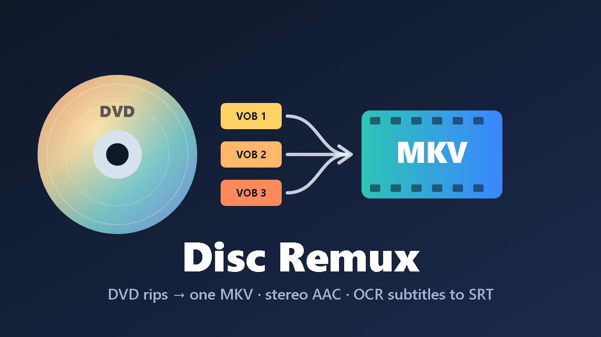

<p align="center"></p>

<h1 align="center">Disc Remux for Jellyfin</h1>

<p align="center">
Turns DVD rips — <code>VIDEO_TS</code> folders and the single <code>VTS_xx_x.VOB</code> that Radarr/Sonarr import — into one
MKV that plays everywhere: the whole film, a stereo AAC track, and text subtitles.
</p>

---

## Why

DVD releases (`*.NTSC.DVD5`, `*.PAL.DVD9`, `VIDEO_TS`) are a disc image, not a video file:

- **Radarr/Sonarr import only one `.VOB`** — a 1 GB piece, about 20–25 minutes of the film.
- A `VIDEO_TS` folder in Jellyfin plays badly: poor seeking, menus and trailers mixed in.
- **AC3/DTS audio** has no sound on many Android TV boxes and browsers unless the server transcodes.
- **DVD subtitles are pictures**. Clients often pick the wrong track or force a full video transcode
  (burn-in), which a small server can't handle.

Disc Remux fixes all of that inside Jellyfin, using Jellyfin's own ffmpeg, without re-encoding the video.

## What it does

1. **Finds the disc**
   - a `VIDEO_TS` folder (or loose `VTS_*.VOB/IFO` files) inside a library, or
   - a lone `VTS_xx_x.VOB` imported by Radarr/Sonarr → looks up the **complete disc in your download
     folders** (same file name and size) and builds the film from that. Download folders are never modified.
2. **Picks the main title** from the DVD's IFO files (the longest program chain) and its VOB set.
3. **Checks it is safe to join**: multi-angle and seamless-branching discs are detected and skipped
   instead of producing a scrambled film.
4. **Joins the VOBs into one MKV** — video stream copied bit for bit, chapters of the film in order.
5. **Audio**: every DVD audio track is kept, with its language and a readable name
   ("Dolby Digital 5.1", "DTS 5.1", "commentary"), plus a **stereo AAC track first and default** that
   every device plays without transcoding.
6. **Subtitles**: each DVD subtitle track is OCR'd with tesseract into `Movie.<lang>.srt`
   using the disc's own colour palette. Forced tracks become `.forced.srt`; your preferred language can
   be marked `.default.srt`. Converted bitmap tracks are dropped from the MKV (optional), languages
   without an OCR model stay in the MKV as bitmap tracks.
7. **Cleans up safely**: the replaced library files are moved to a hidden `.disc-remux-original`
   folder next to the movie (or a folder you choose). **Nothing is ever deleted.** Then the library is
   rescanned.

It runs as a scheduled task (daily 03:00) and — optionally — about a minute after Jellyfin picks up a new
`.VOB`, before your download client removes the finished torrent.

## Supported input

| Input | Supported |
|---|---|
| DVD-Video folder `VIDEO_TS/` (DVD5 / DVD9, NTSC / PAL, 4:3 / 16:9) | ✅ |
| Loose `VTS_xx_y.VOB` + `VTS_xx_0.IFO` in a movie folder | ✅ |
| Single `VTS_xx_y.VOB` imported by Radarr/Sonarr + full disc in a download folder | ✅ |
| Single VOB with **no** complete disc anywhere | ⚠️ reported in the log, left alone |
| Audio: AC3 (Dolby Digital), DTS, LPCM, MPEG | ✅ kept as is (+ AAC stereo) |
| Subtitles: DVD subpictures (VobSub) | ✅ → SRT (OCR) or kept as bitmap |
| Multi-angle / seamless-branching discs | ⛔ detected and skipped |
| `.iso` images | ⛔ extract to `VIDEO_TS` first (Jellyfin can't mount images without root) |
| Blu-ray (`BDMV`, `.m2ts`) | ⛔ not yet |

Output: **Matroska (`.mkv`)**, original MPEG-2 video, original audio tracks, stereo AAC, `.srt` files
next to the film.

## Subtitle languages

**Any language tesseract can read** — not just Bulgarian or English. The DVD stores a language code for
every subtitle track; Disc Remux maps it to the tesseract model (`bg` → `bul`, `de` → `deu`, `zh` →
`chi_sim`, …) and OCRs every track that has a model installed.

- Install the models you need on the Jellyfin host, e.g.
  `apt install tesseract-ocr tesseract-ocr-bul tesseract-ocr-eng tesseract-ocr-deu`
  (list: `apt search tesseract-ocr-`).
- Leave **OCR languages** empty to convert every language that has a model, or limit it (`bg,en`).
- Tracks without a model stay in the MKV as bitmap subtitles.

**Accuracy.** Typical DVD subtitles (plain sans-serif text) come out clean for the vast majority of lines;
mistakes are mostly in names, credits and punctuation. Common artefacts are cleaned automatically
(stray `|`/`I`, detached first letters in Cyrillic like `П рекрасен` → `Прекрасен`, while real
one-letter words such as `В`, `С`, `И`, `I`, `A` are kept). Timing has 0.1 s resolution. It is
OCR — expect the occasional wrong letter, not a hand-made subtitle.

## Install

1. **Dashboard → Plugins → Repositories → +** and add
   ```
   https://raw.githubusercontent.com/HA-HUB-I/jellyfin-plugin-disc-remux/main/manifest.json
   ```
2. **Catalog → Disc Remux → Install**, then restart Jellyfin.
3. Optional, for subtitle OCR: install tesseract and language models on the Jellyfin host (see above).
   Docker users: extend the image (`FROM jellyfin/jellyfin` + `apt-get install tesseract-ocr …`) or leave
   OCR off.

Requires **Jellyfin 12.2+**.

### Updates

New versions are published to the same repository. Jellyfin checks it automatically
(**Dashboard → Scheduled Tasks → Update Plugins**) and installs updates; restart Jellyfin afterwards.

## Use

1. **Dashboard → Plugins → Disc Remux**: set your download folder(s) under *Source folders*, turn on
   **Dry run** for the first time.
2. **Dashboard → Scheduled Tasks → Disc Remux → Convert DVD rips to MKV → ▶**.
3. Check **Dashboard → Logs**: every disc is listed with its title length, audio and subtitle tracks and
   what would be done. Turn Dry run off and run again.

### Settings

| Setting | Default | Notes |
|---|---|---|
| Scan all video libraries | on | music/book/photo libraries are skipped |
| Source folders | — | download folders with complete discs, one per line |
| Process as soon as a VOB is added | on | |
| Add stereo AAC as default audio | on | 192 kbit/s |
| Convert DVD subtitles to SRT (OCR) | on | needs tesseract |
| OCR languages | all installed | ISO 639-1 list to limit |
| Default subtitle language | — | that SRT becomes `.default.srt` |
| Drop converted bitmap tracks | on | prevents clients picking the bitmap track |
| Move replaced files to | `.disc-remux-original` next to the movie | |
| Dry run | off | |

### Processing time

Joining is I/O bound (≈ 4–6 min for a 4.5 GB DVD5 over SMB). OCR takes a few minutes per subtitle
track on a 2-core CPU. Only one disc is processed at a time.

## Tip for Radarr

Stop DVD releases from being grabbed in the first place: add a custom format with a *Release Title*
condition

```
(?<![a-z0-9])(DVD[ .-]?[59]|DVD[ .-]?R|DVDR|ISO|VIDEO[ ._-]?TS|BDMV|M2TS|COMPLETE[ .-](UHD[ .-])?BLU-?RAY)(?![a-z0-9])
```

score it `-10000` in your quality profiles and keep *Minimum Custom Format Score* at `0`.
Disc Remux then only has to handle the occasional manual grab.

## Build from source

```sh
dotnet test -c Release
dotnet publish Jellyfin.Plugin.DiscRemux -c Release -o publish
# copy publish/Jellyfin.Plugin.DiscRemux.dll to <jellyfin data>/plugins/Disc Remux_<version>/ and restart
```

Releases are automatic: push a tag `vX.Y.Z` → GitHub Actions runs the tests, builds the plugin, publishes
a GitHub release with the zip and adds the version to `manifest.json`.

## Български

Добавка за Jellyfin, която превръща DVD рипове (`VIDEO_TS`, или единичния `VTS_xx_x.VOB`, който
Radarr внася) в един MKV файл: целият филм, допълнителна стерео AAC пътечка (звук на всеки телевизор) и
текстови субтитри `.srt`, разпознати от DVD картинките с tesseract — **на всеки език, за който има
инсталиран езиков модел** (`tesseract-ocr-bul`, `-eng`, `-deu`…). Нищо не се трие — оригиналите се
местят в скрита папка `.disc-remux-original`. Инсталира се и се обновява автоматично от адреса на
хранилището по-горе.

## License

GPL-3.0, like Jellyfin.
